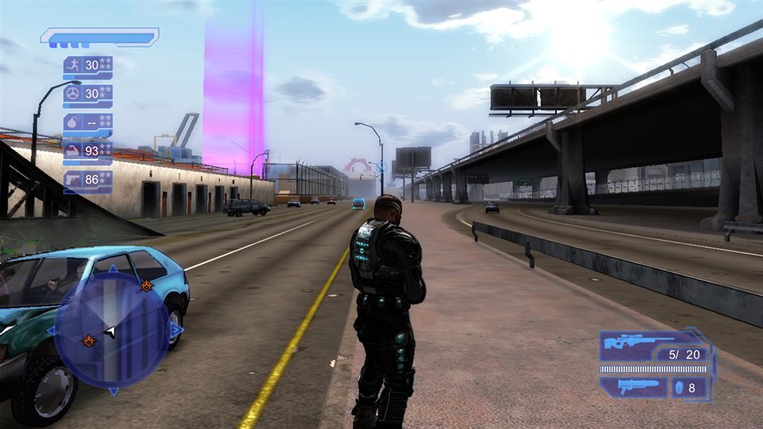
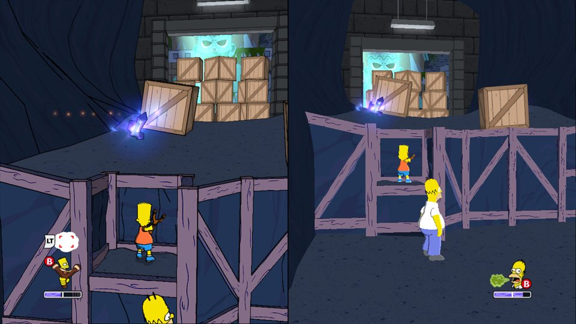
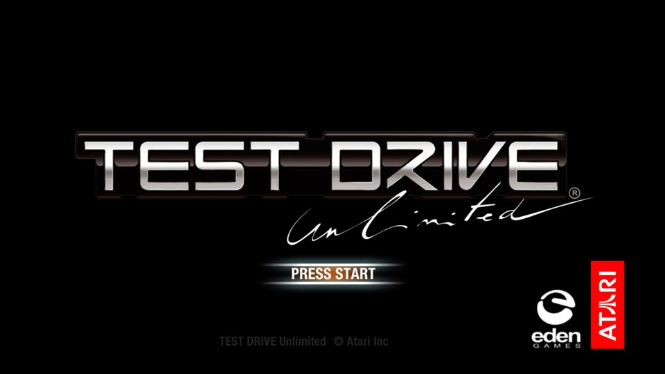
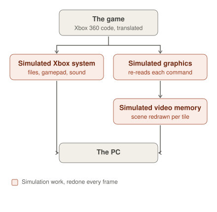
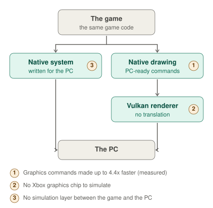
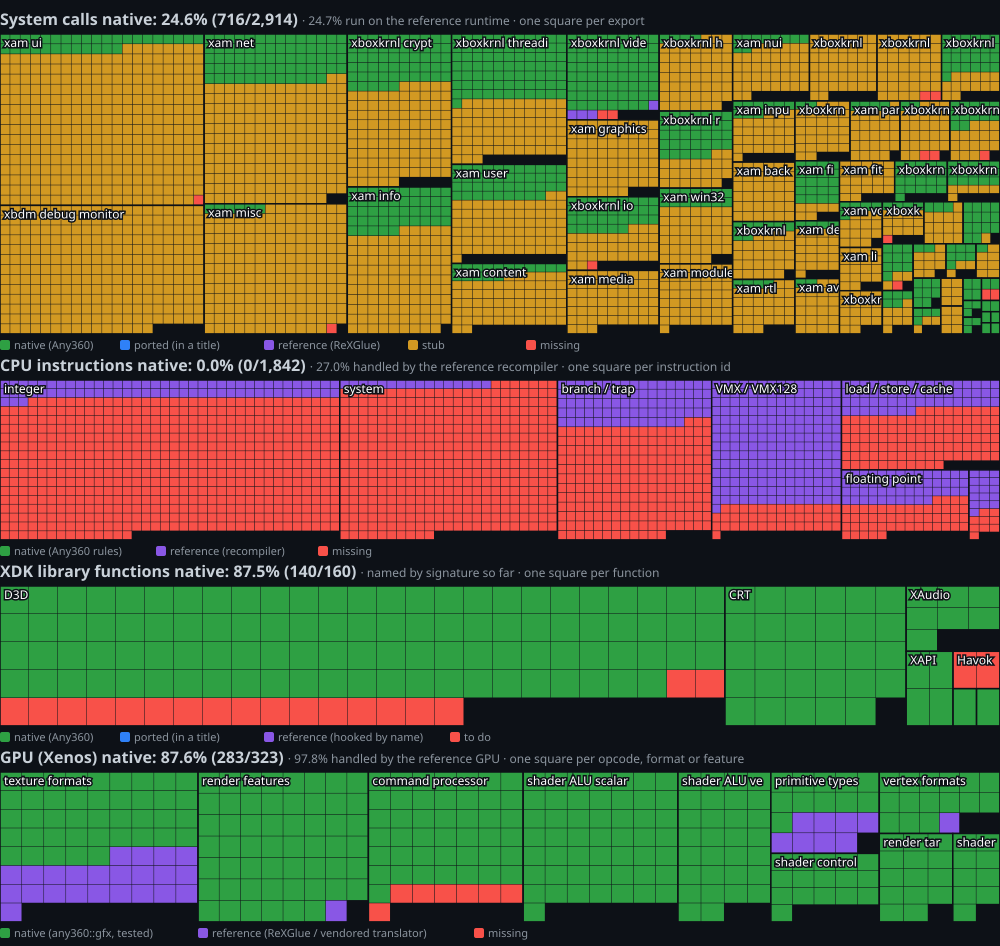

# Any360

**A toolkit for turning Xbox 360 games into portable native codebases.** It starts from a static recompilation
([ReXGlue](https://github.com/rexglue/rexglue-sdk)), which runs the game on day one and serves as the reference,
then replaces, piece by piece, what the recompilation still simulates, and finally the game's own code, each piece
checked against the original. The goal is a game that builds natively for Windows, Linux, macOS, Android, x86-64,
ARM64 and WebAssembly from the player's own copy of the game data, the way the projects on
[awesome-decomp-games](https://submitgame.github.io/awesome-decomp-games/) do. What one title needed is reused by
the next: Any360 lists every function of the platform a port must provide, and how much of it is native.

Started from the [Crackdown port](https://github.com/GaetanVigner/CrackdownRewrite) (ReXGlue v0.10.0, 120 SDK patches,
native Vulkan renderer in progress, 103 functions already rewritten). Next title:
[The Simpsons Game](https://github.com/GaetanVigner/TheSimpsonsGameRewrite).

## Games running on Any360

Each frame below was drawn by Any360's own renderer (`any360::gfx`, Vulkan) from the game's recompiled code. Click a
game to open its repository.

| [Crackdown](https://github.com/GaetanVigner/CrackdownRewrite) | [The Simpsons Game](https://github.com/GaetanVigner/TheSimpsonsGameRewrite) | [Test Drive Unlimited](https://github.com/GaetanVigner/TDURewrite) |
|:---:|:---:|:---:|
|  |  |  |
| Pacific City, in game | Split-screen co-op | Title screen |

Started on 2026-11-11: [Call of Duty: Black Ops](https://github.com/GaetanVigner/CoDBoRewrite), the fifth title, recompiled and
running its first minute and a half on `any360::sys` and `any360::gfx` alone, with the network it needed (its local
server's sockets, kept on the machine).

**No game data, no game binaries.** Any360 holds the toolkit, the system layer, the renderer and reports made of counts,
hashes, addresses and public API names. A title's reconstructed source lives in that title's own repository. Bring
your own copy of the game.

## How it works

A static recompilation already runs an Xbox 360 game on a PC: the game's code is translated once. But every frame
the PC still pretends to be an Xbox 360 (left): it simulates the console's system and its graphics chip,
re-reading each graphics command the game writes and redrawing the scene tile by tile, as the console's video
memory required. Any360 keeps the same game code and replaces these simulated parts with code written for the PC
(right), one function at a time, each checked against the original before the game uses it.

That is where the performance comes from: graphics commands prepared up to 4.4 times faster (measured function by
function, none slower), no Xbox graphics chip left to simulate, and no simulation layer between the game and
Windows or Linux. Once nothing is simulated, the game's own code is rewritten the same way, until it builds as an
ordinary native codebase. The stages and milestones are in [docs/DESIGN.md](docs/DESIGN.md).

<table>
<tr><th>ReXGlue alone: the PC simulates an Xbox 360</th><th>Any360: the simulated parts replaced</th></tr>
<tr>
<td></td>
<td></td>
</tr>
</table>

## Progress

Live page: **https://gaetanvigner.github.io/Any360/** (click the map).

The database, the layers, the tools and how to run them: [docs/REPOSITORY.md](docs/REPOSITORY.md).

## State

The system binding's road to 100%: every system call of any title on `any360::sys`, then Any360 hosting titles without
ReXGlue's runtime, then porting a new title with no title-specific code in Any360. Each step ends with an in-game check;
details in [docs/SYS_BINDING.md](docs/SYS_BINDING.md). Crackdown is the test bench, not the goal.

| Step | What | State |
|---|---|---|
| 0 | the binder: a title's imports overridden by `any360::sys`, group by group, the runtime as fallback | done |
| 1 | stateless calls: strings, time, crypto, console information | done (Crackdown) |
| 2 | files: `Nt*File`, Win32 files, symbolic links, the runtime's mounts | done (Crackdown) |
| 3 | objects and waits: events, semaphores, mutants, timers, completion ports | done (Crackdown) |
| 4 | threads: creation, TLS, APCs, DPCs, critical sections, hardware threads | done (Crackdown) |
| 5 | memory: virtual and physical allocation, one address space shared with the runtime | done (Crackdown) |
| 6 | XAM: profile, saves, notifications, enumerators, the network (loopback sockets) | done (Crackdown; the network for Call of Duty: Black Ops) |
| 7 | audio: XAudio clients, the XMA registers, a native XMA decoder, SDL3 output | done (Crackdown) |
| 8 | input: gamepads through `any360::sys` (packets, keystrokes, vibration), the host's drivers as the source, every change queued for the title at any frame rate | done (Crackdown, gamepad and vibration; keyboard and mouse not checked) |
| 9 | no call reaching the runtime: every path, the raw hard drive devices, the profile defaults on `any360::sys` | done (Crackdown; the host stays ReXGlue's until step 13) |
| 10 | a second title (The Simpsons Game) on the full system binding | done (all groups, levels, saves, sound, gamepad) |
| 11 | third and fourth titles (Test Drive Unlimited, Sonic 06) | partial: Test Drive Unlimited boots to its title screen with all eight groups on `any360::sys` and no call reaching the runtime; gameplay, saves and sound not checked yet; Sonic 06 not started |
| 12 | paths no title took yet: `XMA*` decoding, STFS packages, several users, guide UIs, Live offline, xbdm | partial: 842 of 2,914 exports native with scenario tests; the reference stubs sorted ([docs/SYS_STUBS.md](docs/SYS_STUBS.md)): none left to implement, all 114 Xenia stubs too answered natively (avatars, media, profile and user, content, information, Kinect, settings and others, guide screens, modules, input, network and notifications, the SMC and the last ones) (2 object and module calls, 10 content, network, callback and thread look-up calls, 9 language, memory, Xapi, IPTV and LZX decompression calls, 24 cryptography and key calls, 14 Win32 forms, 19 XAM information calls, 11 kernel calls, 16 guide and Kinect calls and 17 profile calls done), 255 debug only, 1,799 never seen |
| 13 | Any360's own host: XEX loader, address space, threads, guest dispatch, MMIO, devices | not started |
| 14 | the platform layer: window, input, audio, presenter on Windows and Linux (Steam Deck) | partial: SDL3 audio output only |
| 15 | graphics through `any360::gfx` only, no `rexgpu-xenos` | partial: three titles draw through `any360::gfx`, the GPU session's plan in [docs/GFX.md](docs/GFX.md) |
| 16 | porting a new title: a converter served from GitHub (as AnyPS5) and built into the cross-platform launcher, from a XEX to a running build with no title-specific code in Any360 | not started |

Stages 2 and 3 (decompilation, the portable codebase) follow; Crackdown has 103 functions decompiled.

## License

BSD 3-Clause ([LICENSE](LICENSE)). ReXGlue, which stage 0 patches and links, is BSD 3-Clause too; see
[NOTICE.md](NOTICE.md) for what the repository may and may not contain.
