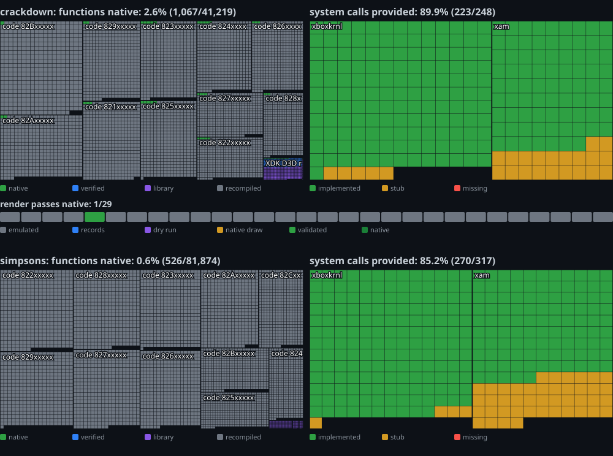

# Any360

**A reusable native-port layer for Xbox 360 static recompilations built with
[ReXGlue](https://github.com/rexglue/rexglue-sdk)**, the way [AnyPS5](https://boykopovar.github.io/AnyPS5/progress.html)
is for PS5 titles: everything that replaced emulation in one port, packaged so the next port starts from it, and a
progress page that says what each title still runs on emulation.

Started from the [Crackdown port](https://github.com/GaetanVigner/CrackdownRewrite) (ReXGlue v0.10.0, 120 SDK patches,
native Vulkan renderer in progress). Next title: [The Simpsons Game](https://github.com/GaetanVigner/TheSimpsonsGameRewrite).

**No game code, no game data.** The repository holds SDK patches, host code, tools, and reports made of counts, hashes,
addresses and public API names (kernel exports, instruction mnemonics). Bring your own game to the ports.

## What is here

| | |
|---|---|
| [docs/DESIGN.md](docs/DESIGN.md) | What belongs in the layer and what stays with a game; how a title consumes it (pinned SDK + patch series, with a CMake package); the renderer record model; the measuring rules; milestones |
| [docs/progress.html](docs/progress.html) | Progress page: system calls, instructions, native functions and layer components, one column per title ([progress.json](docs/progress.json), [progress.svg](docs/progress.svg)) |
| [docs/coverage/](docs/coverage/) | Per-title coverage reports: [crackdown](docs/coverage/crackdown.md), [simpsons](docs/coverage/simpsons.md), [comparison](docs/coverage/COMPARISON-crackdown-vs-simpsons.md), and the Crackdown [SDK patch inventory](docs/coverage/patches-crackdown.json) |
| [docs/COMPARISON.md](docs/COMPARISON.md) | What the comparison says: where a second title costs effort (the GPU), where it does not (kernel, CPU) |
| [layer/status.json](layer/status.json) | The layer's components, where each comes from, and its state |
| [tools/coverage.py](tools/coverage.py) | Given a recomp's generated code and an SDK tree: imports (implemented / stub / missing), instruction mnemonics (handled or not), native functions; `--compare` two titles |
| [tools/patch_inventory.py](tools/patch_inventory.py) | Classifies an SDK patch set by SDK area |
| [tools/progress_page.py](tools/progress_page.py) | Regenerates the progress page from the reports |



## Running the tools

Standard-library Python 3.11+. Paths below are the Crackdown and Simpsons checkouts next to this repository.

```bash
python tools/coverage.py --name crackdown --generated ../crackdown-xbox360-recompiled/generated/default --sdk ../crackdown-xbox360-recompiled/out/rexglue-sdk-src --port-src ../crackdown-xbox360-recompiled/src
```

```bash
python tools/coverage.py --name simpsons --generated ../TheSimpsonsGameRewrite/simpsons/generated/default --sdk ../TheSimpsonsGameRewrite/tools/rexglue-sdk --port-src ../TheSimpsonsGameRewrite/simpsons/src
```

```bash
python tools/coverage.py --compare docs/coverage/crackdown.json docs/coverage/simpsons.json
```

```bash
python tools/patch_inventory.py --name crackdown --patches ../crackdown-xbox360-recompiled/patches/rexglue-sdk --purposes ../crackdown-xbox360-recompiled/docs/rexglue-patches.md --game-words crackdown
```

```bash
python tools/progress_page.py
```

`--generated` is the ReXGlue codegen output (`*_init.cpp` for the import table, `*_recomp.*.cpp` for the instruction
comments); `--sdk` an SDK source tree (`src/kernel`, `src/codegen/instruction_dispatch.cpp`, `thirdparty/disasm/ppc-dis.c`).
Generated code is never committed here: run the tools against your local tree and commit the reports.

## State

Milestone L1 (skeleton, design, coverage of both titles, progress page). The layer's code (SDK patch series, HLE
record model, PM4 decoder, guest sandbox) still lives in the Crackdown repository; [layer/status.json](layer/status.json)
lists each piece and [docs/DESIGN.md](docs/DESIGN.md#7-first-milestones) the order they move in.

## License

BSD 3-Clause ([LICENSE](LICENSE)). ReXGlue, which the layer patches and links, is BSD 3-Clause too; see
[NOTICE.md](NOTICE.md) for what the repository may and may not contain.
